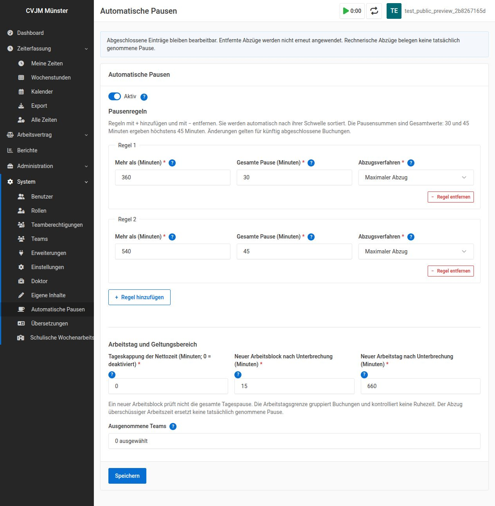

# Automatic Breaks for Kimai

Automatically add configurable breaks when a time entry is first completed in Kimai. Keep the original start and end times, show users what was deducted, and allow manual corrections.

**Example with the installation defaults:** an entry lasting 6 hours 15 minutes receives a 15-minute break, leaving 6 hours of recorded work. At exactly 6 hours, nothing is deducted.

> This plugin applies an accounting policy. It cannot determine whether someone actually took a break, and it does not certify compliance with working-time law. Review your organization's policy before enabling it for employees.

## Vibecoding notice

This plugin was written entirely with AI assistance and is tested by humans. We actively use it on a Kimai instance with ~30 users. We update our Kimai installation regularly and maintain the plugin alongside it.

Found a bug or have an idea for improvement? Issues, pull requests and discussions are welcome. Your feedback helps make the plugin more useful and reliable for everyone.

## Features

- One to ten rules with individual **Maximum deduction** or **Fixed deduction** modes.
- Rule cards with add/remove buttons, automatic sorting, and help available by hover, keyboard focus or tap.
- Existing manual and automatic breaks credited against required totals.
- Configurable work-block and workday boundaries; optional person-wide team exemptions.
- Integration with Kimai forms, timer stops, REST API and supported Kiosk clock-outs.
- Translated notices showing the amount actually added after a successful save.
- Editable breaks, review flags for ambiguous entries, and metadata for listings/exports.
- No Kimai core patches, additional runtime Composer packages or new database tables.

## Requirements

| Component | Requirement / tested baseline |
| --- | --- |
| Kimai | Self-hosted Kimai 2.66.0 or later; tested on 2.66.0. Later versions are not automatically guaranteed compatible. |
| PHP | 8.2 or later; tested on 8.2 and 8.4 |
| Database | MySQL/MariaDB with named locks. PostgreSQL and SQLite are not supported. |
| Server access | Ability to install a plugin and run Kimai console commands |
| Optional Kiosk integration | Tested with KioskBundle 2.17.0; purchased/installed separately |

Kiosk is optional and is only needed if you want to record time at a terminal.

## Installation

1. **Back up the Kimai database and installation.** First try the plugin in a development instance. The plugin is enabled by default as soon as Kimai loads it, so schedule installation when you can review settings before users resume booking.
2. Download a release archive from this repository and extract it outside the active plugin directory. GitHub source archives usually add a repository/version directory around the files.
3. Copy the extracted plugin contents into **exactly** `var/plugins/AutomaticBreaksBundle` inside your Kimai installation. Do not keep an extra nested folder or a version suffix. The result must include:

   ```text
   kimai/
   └── var/plugins/AutomaticBreaksBundle/
       ├── AutomaticBreaksBundle.php
       ├── composer.json
       ├── Calculation/
       └── Resources/
   ```

4. Ensure that the PHP/web-server user can read the plugin files. From the **Kimai root**, run the following as the same system user used for Kimai maintenance, using the PHP version serving Kimai:

   ```bash
   php bin/console kimai:reload --env=prod --no-interaction
   ```

   On a typical Debian installation that user is `www-data`; adapt to your server:

   ```bash
   sudo -u www-data php bin/console kimai:reload --env=prod --no-interaction
   ```

   No plugin installer command, Composer installation or schema migration is required. Do not run `composer require` for this plugin in the Kimai root. For containers, keep the plugin in a persistent volume or your image and execute the reload command inside the Kimai container.
5. Enable **Breaks** under **System → Settings → Time tracking**. Automatic deductions only run while this Kimai setting and the plugin’s **Active** switch are both on.
6. Sign in with the **`system_configuration` permission** and open **System → Automatic Breaks** (German: **System → Automatische Pausen**). The route is `/{locale}/admin/automatic-breaks`. Review all values, exclusions and the Active switch, then save.
7. In your development instance, create a test entry without other entries in the same workday. Verify the examples below, its break field and its notice. Delete only your test data afterward.

If breaks are disabled in Kimai, a warning appears at the top of the plugin settings page. Your rules stay saved, but no new automatic deductions are made. Re-enabling breaks does not recalculate completed entries. You may need to sign in again before opening settings if your session was restored with Remember me.

Installation follows [Kimai's plugin-management workflow](https://www.kimai.org/documentation/plugin-management.html).

## Default settings

You can start with these settings and adjust them to suit your workplace. Existing saved settings are kept when you update the plugin.



*Settings page in German, shown with a test account. English is also supported.*

| Setting | Default |
| --- | --- |
| Active | Yes |
| Rule 1 | More than **360 minutes**, up to **30 minutes** total break, **Maximum deduction** |
| Rule 2 | More than **540 minutes**, up to **45 minutes** total break, **Maximum deduction** |
| Maximum working time deduction | **0 — disabled**; overtime remains recorded |
| New work block after interruption | **15 minutes** |
| New workday after interruption | **660 minutes (11 hours)** |
| Excluded teams | None |

All form durations are in **minutes**. Calculation uses elapsed **seconds**. For example, a display rounded to `6:00` can conceal additional seconds or preceding entries. Exactly `6:00:00` in an otherwise empty block does not trigger a rule; `6:00:01` does.

### Maximum versus fixed deduction

**Maximum deduction** adds only the time beyond the threshold, up to the rule's total. **Fixed deduction** requires the whole rule total immediately after crossing the threshold. Rules specify **total** breaks, not increments: 30 followed by 45 means 45 altogether, not 75.

For one isolated entry with no manual break and the daily cap disabled:

| Recorded duration | Maximum total break (default) | Fixed total break |
| --- | --- | --- |
| 6:00:00 | 0 | 0 |
| 6:00:01 | 1 second | 30 minutes |
| 6:01 | 1 minute | 30 minutes |
| 6:15 | 15 minutes | 30 minutes |
| 6:30 | 30 minutes | 30 minutes |
| 9:00 | 30 minutes | 30 minutes |
| 9:01 | 30 minutes | 45 minutes |
| 9:30 | 30 minutes | 45 minutes |
| 9:31 | 31 minutes | 45 minutes |
| 9:45 | 45 minutes | 45 minutes |
| 12:00 | 45 minutes | 45 minutes |
| 24:00 | 45 minutes | 45 minutes |

The second maximum rule retains the first rule's 30-minute total. It increases that total only above 9:30 recorded time, until 45 minutes at 9:45. A 24-hour entry is **not** split automatically into calendar days: it retains 23:15 recorded work and needs human review. Such examples describe the calculation, not an acceptable work schedule.

Existing breaks reduce the **additional** deduction. An eight-hour entry with 15 minutes of manual break receives another 15 minutes, not another 30. Notices report the added amount. Mixed modes are supported; a later rule never reduces the total already required by an earlier rule.

Use **+** and **−** to add or remove rule cards. New cards start in maximum mode. Cards sort by threshold after an edit is committed. Thresholds must be distinct, totals must not decrease, and at least one rule must remain. Saving validates and sorts rules again on the server. Changes apply to future completions, including currently running timers when they are stopped.

### Work blocks and workdays

A **work block** combines recorded intervals until a clock-out gap reaches the block-reset value. Project changes without a sufficiently long gap remain in the same block. Unrecorded gaps never count as work.

With the default 15-minute reset, four hours of work, a 15-minute clock-out gap and another four hours form **two blocks**. Neither block crosses six hours, so the plugin adds no break. It does **not** verify that the total daily pause is sufficient. Setting the block reset to **0** combines intervals across gaps until the workday boundary; it does not automatically credit those gaps as native break amounts.

A **workday** starts again after a gap of at least 660 minutes by default. Midnight alone does not reset either counter. Durations use elapsed seconds across daylight-saving changes. The workday gap must be positive and at least as long as the block-reset gap. It is a grouping rule, not a legal rest-period check.

### Optional daily cap

The daily net-time cap field is an **automatic deduction**, not a warning or a limit on entering time. A positive value converts excess net time across all blocks of the workday into break time, limited by the duration available in the newly completed entry.

It is disabled by default because it can hide overtime: with a 600-minute cap, a 24-hour entry would receive 14 hours of total break. Leave it at **0** if recorded overtime must remain visible. The plugin does not currently provide overtime alerts.

### Team exemptions

Membership in **any** excluded team exempts the entire person, including their work for other projects or teams. This is not a per-project or per-booking exception. Kimai does not identify one working team on each time entry.

## Corrections and historical entries

- Only first completion triggers calculation. Running timers have no deduction yet.
- Completed entries remain editable under normal Kimai permissions. Editing times or removing a break does not trigger automatic recalculation.
- The original automatic deduction remains internal accounting credit, so a removed deduction is not silently transferred to a later entry. Manual corrections can therefore leave totals below the configured break requirement.
- New backdated entries use preceding history; later completed entries are not rewritten. Batch completions are processed chronologically.
- Overlapping records, competing open timers and insufficient duration for a required deduction are marked for manual review. A deduction cannot make the new entry's net duration negative.
- The plugin preserves timestamps. A native break duration does not establish when a break occurred.

## Notices and languages

After a positive automatic deduction is committed, supported Kimai forms and Kiosk result screens show a notice containing the **actual added amount**. Failed saves, zero deductions, repeated stop requests and manual corrections do not generate new deduction notices.

You can customize notification text through Kimai’s optional Translations plugin. Developers can use the [notification reference](docs/NOTIFICATIONS.md) to connect other applications.

English, German and Swiss German include the latest settings/help text. Existing notification and metadata catalogues cover 45 locales; some other languages retain older help wording and new keys fall back to English. Native-speaker contributions are welcome. Optional Kimai translation overrides can replace the message templates without editing plugin files.

## Updates, disabling and removal

Back up code and database before an update. Replace the complete plugin directory during a maintenance window; retain the old version **outside** `var/plugins` and the public web root. Reload Kimai with the installation command and verify settings and a test booking.

Your saved settings and completed entries are kept during updates. Review your settings after replacing the plugin. See [update instructions](docs/UPGRADE.md) for backup and rollback guidance.

To stop deductions while keeping the interface, turn off **Active** and save. To disable/remove the bundle itself, follow [Kimai's plugin instructions](https://www.kimai.org/documentation/plugin-management.html) and reload the cache. Existing breaks, metadata and saved configuration remain in the database. Reinstalling does not reset that configuration. There is no automatic reversal of past deductions.

For rollback, restore compatible plugin code **and** its saved configuration. Do not restore an old database over new bookings merely to roll back the plugin.

## Troubleshooting

| Symptom | Check |
| --- | --- |
| Plugin or menu missing | Exact directory name, readable files, compatible versions, cache reload, `system_configuration` permission and any `.disabled` file |
| Settings request asks for login | Full authentication is required even if the menu is visible in a remembered session |
| Unexpected deduction near six hours | Exact seconds, preceding entries, block gaps, manual break credit, rule mode and optional daily cap |
| No deduction | Enable Breaks in Kimai and Active in the plugin. Then check team exemptions, whether the entry was already completed, block gaps and existing breaks. |
| Help or rule buttons unresponsive | Reload the page; inspect browser errors and any Content Security Policy blocking the plugin's inline scripts |
| Error after upgrade | Check PHP/Kimai compatibility and application logs, then restore the previous release and matching policy if necessary |

Do not include credentials, bearer tokens, employee names or real time records in public issues. A useful report includes versions, anonymized policy values, exact timestamps/gaps, manual break amounts, expected/actual results and a redacted error message.

## Known bugs

- **MariaDB 11.8:** simultaneous completions can fail with error 1020 when `REPEATABLE READ` and snapshot isolation are enabled. Both concurrency tests pass with `READ COMMITTED`. The plugin does not change database settings or retry failed bookings. See [details and test instructions](docs/VALIDATION.md#mariadb-118-snapshot-isolation).

## Development and license

The source is licensed under [AGPL-3.0-or-later](LICENSE). It is an independent Kimai plugin. Optional third-party plugins have their own licenses and are not bundled.

See [development and validation](docs/VALIDATION.md), [code review](docs/CODE_REVIEW.md) and [scope and legal distinctions](docs/RESEARCH.md). Tests run inside a development Kimai installation using its Composer development dependencies. Never run fixture-writing integration tests against production.
